# TapTrack Superadmin User Manual

**Notre Dame of Marbel University — Smart Attendance Management System**  
Version 1.1 · September 18, 2026 · Internal university use only

This manual explains the tasks available to a TapTrack **Superadmin**. Screen contents may differ as records and the active academic period change.

> **Security:** Use only your assigned account. Do not share passwords, leave a signed-in workstation unattended, or include live credentials in printed copies of this manual.

## 1. Sign in and navigate

Open the TapTrack URL supplied by MIS using Chrome or Edge on the university network. Enter your username and password, then select **Sign in**. Contact MIS if the account is inactive or the password is unavailable.

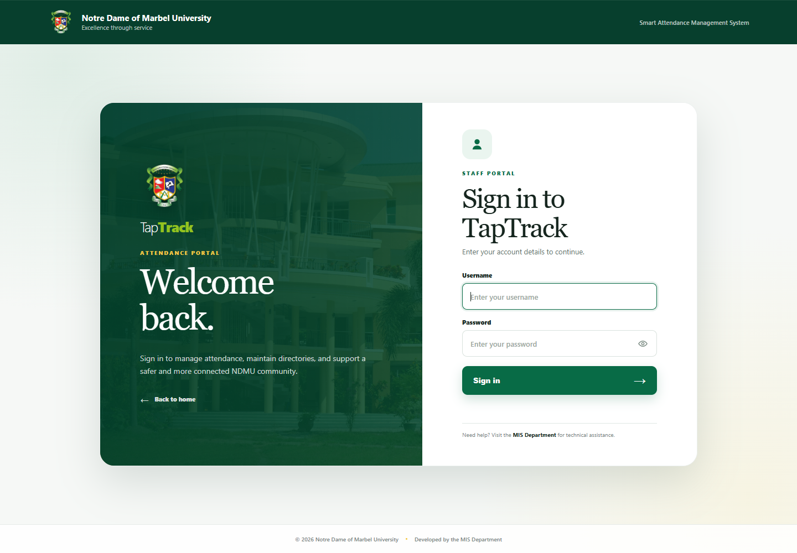

After signing in, use the menu button at the upper-left to open the navigation panel. The panel contains:

- **Overview** and **University entrance logs**
- **Events**: Event management and Past events
- **Library**: Library entrance logs and Internet section logs
- **Maintenance**: student, alumni, and employee directories; academic records; kiosks; and system settings
- **Users & access**: activity logs, permissions, and user accounts
- **Password** and **Sign out** at the bottom

The current academic period appears at the upper-right. Confirm it before recording attendance or creating events.

The collapsed sidebar keeps the same icon sizes as the expanded sidebar. Hover over an icon to see its module name. Selecting a module that contains submodules, or selecting the user profile at the bottom, automatically expands the sidebar.

## 2. Overview

The Overview shows how many people are currently inside, the number of registered students and employees, and today's latest university entrance activity. Select **View all** to open the complete entrance log.

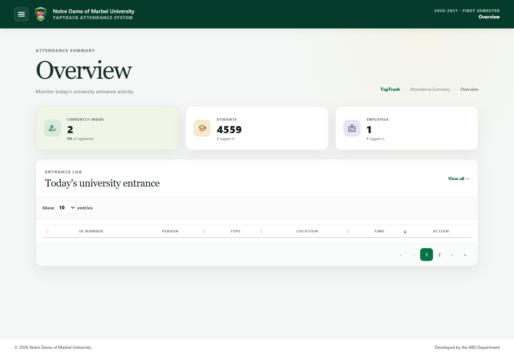

## 3. University entrance logs

Open **University entrance logs** to review Time In and Time Out records.

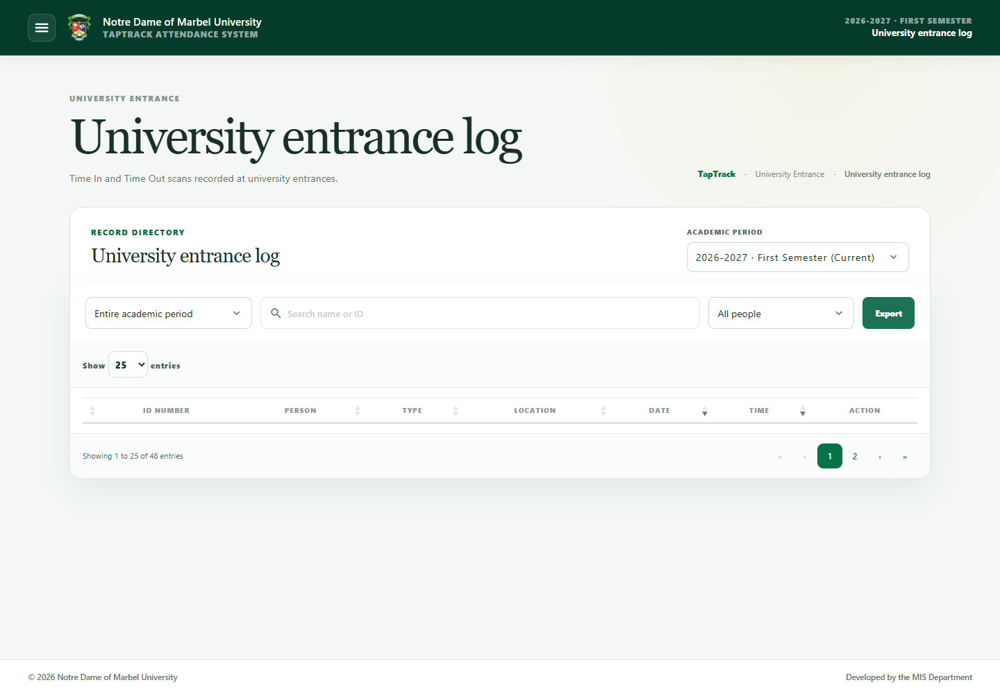

Use the page to:

1. Select an academic period when reviewing historical data.
2. Search by ID number or name.
3. Filter or sort records using the available table controls.
4. Export records when an export control is available.
5. Select a person's row/action to review or export that person's attendance.

Location identifies the terminal where the ID was scanned. The latest entrance time is displayed in the entrance records. A scanner being assigned or paired is configuration activity and does not itself create an attendance log.

## 4. Event attendance

### 4.1 Create and manage an event

Open **Events → Event management**. Select **Add event**, complete the event name, schedule, audience, scan limits, and other required fields, then save.

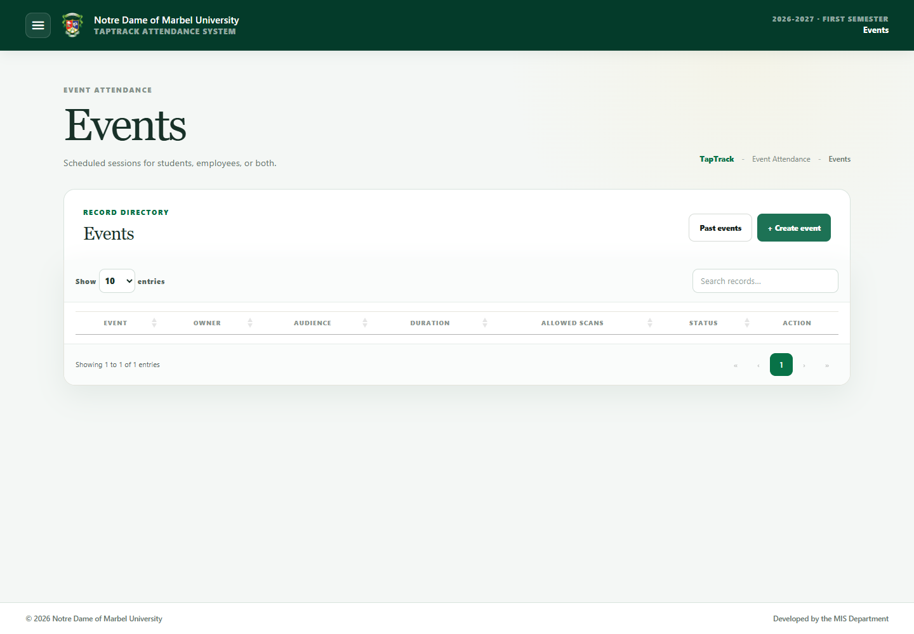

Important behavior:

- Event access follows the user's assigned permissions and visible-people scope.
- Event owners can see current and historical events associated with their account.
- Superadmins and Administrators can see all events.
- Students, employees, or both may be accepted according to the event configuration.

Use the action for an event to open its scanner, edit details, export attendance, or perform other available management tasks. On the scanning page, type/scan the ID and confirm that the person's identity and action are correct. The latest Time In or Time Out display clears after 30 seconds and is not restored when the page reloads.

### 4.2 Correct an event scan

When permitted, open the event attendance records and choose the affected record. Update the action/time or delete the incorrect scan. Enter the required reason. TapTrack retains correction details for audit purposes.

### 4.3 View past events

Open **Events → Past events**, select the academic period, and use search/filter controls to find an event. Export attendance or corrections when needed.

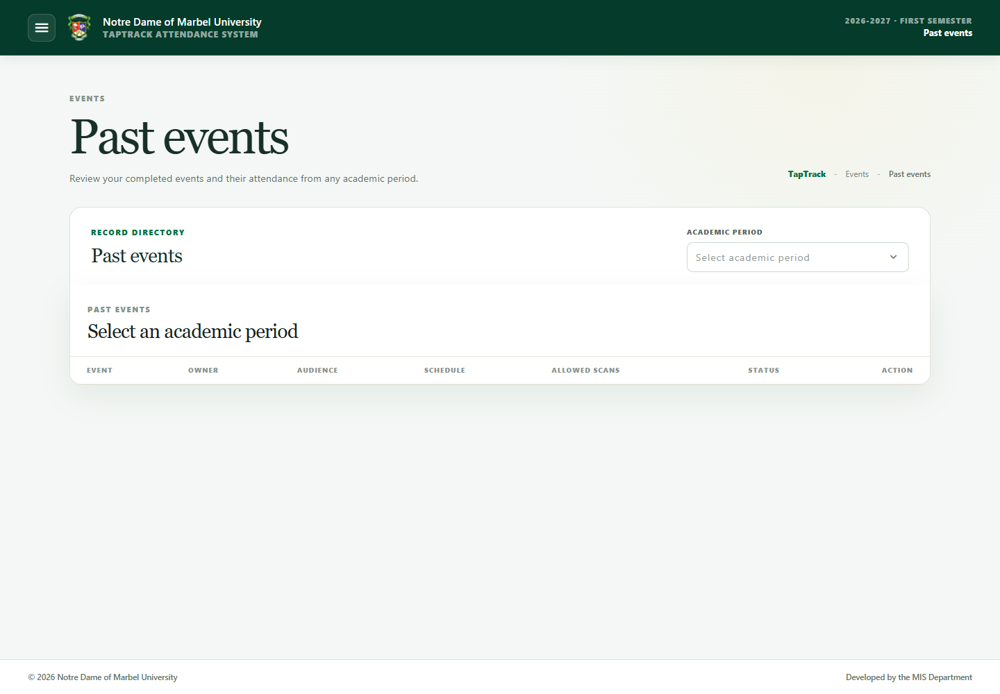

## 5. Library and Internet Section

Open the corresponding page from the **Library** menu. Both pages show the person's ID, name, type, current/previous scan information, and scan time as available.

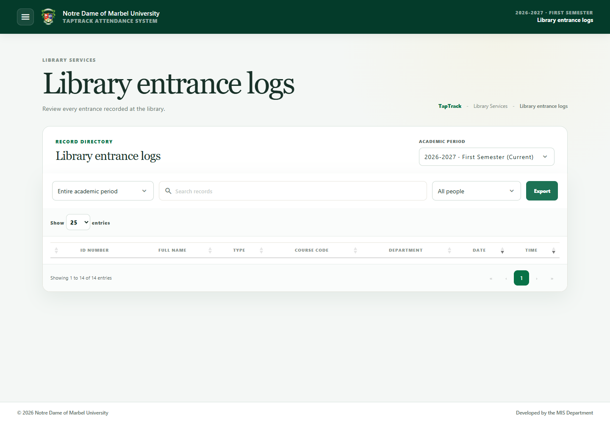

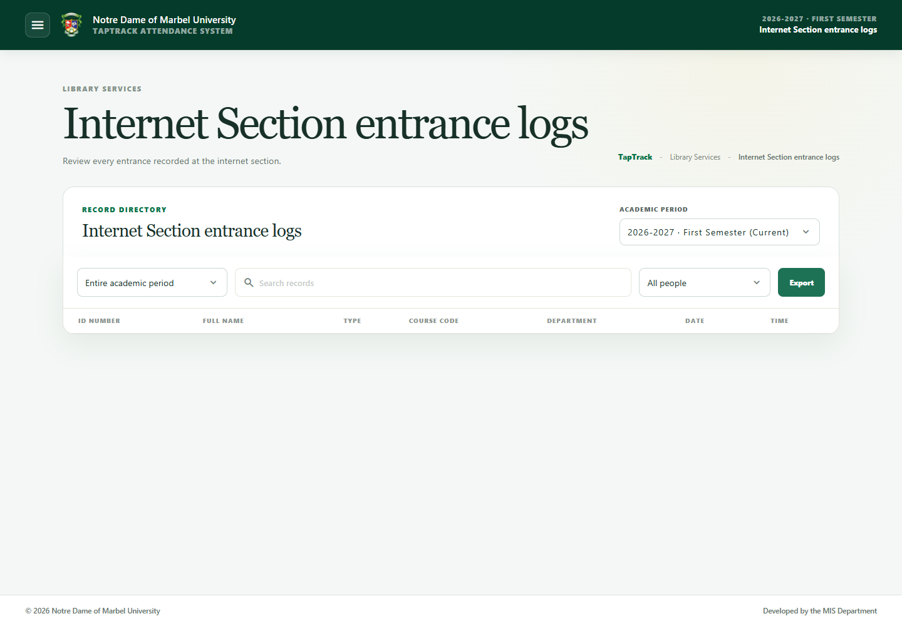

Search or sort the table to find a record. Use the individual export action when a person's attendance is required, and select the academic period in the export dialog.

## 6. Student directory

Open **Maintenance → Students**. Student names are displayed as **Last name, First name Middle name** and are sorted by name. The ID number is the first table column.

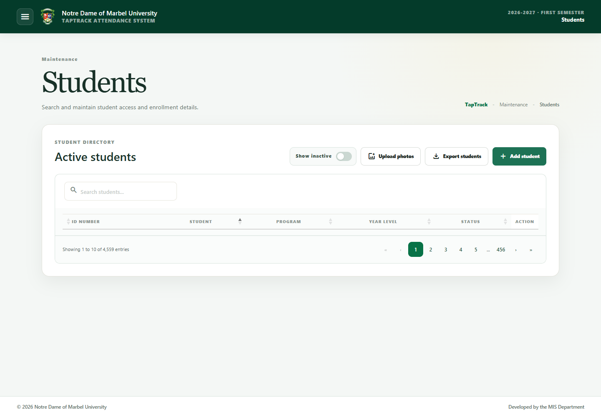

### Add one student

1. Select **Add student**.
2. Enter the required identity and academic information.
3. Optionally choose a JPEG, PNG, or WebP profile photo.
4. Confirm whether the record should be active.
5. Select **Save**.

The photo is uploaded only when the student record is saved. The activity log identifies the new student.

### Edit, deactivate, or reactivate

Open **Manage** on the row and choose the required action. Saving an edited record also uploads a newly selected photo. Deactivation requires confirmation in a modal. Turn on **Show inactive** to find inactive records and reactivate them when authorized.

If an inactive student scans an ID, TapTrack instructs the student to visit the MIS Office for account reactivation.

### Bulk import

Use the import action and the current template. Match the required columns and review the summary before completing the import. A re-uploaded matching inactive student becomes active again. Bulk activity is recorded as one log entry showing how many rows were added.

### Import enrolled students from SQL Server

Only a **Superadmin** or **Administrator** can see and use **Import SQL Server**.

1. Open **Add student**, then select the SQL Server import option.
2. The import uses the current active academic period automatically.
3. Select **Preview import**. A processing message remains visible while TapTrack reads and validates the registrar view.
4. Review **New students**, **Updates**, and **Invalid rows** separately. Each group displays its own records; use its load-more control to view the next batch.
5. Correct invalid registrar data before importing. Supported gender values are **Male** and **Female**.
6. Review how many currently active students are absent from the selected enrollment source.
7. Leave **Confirm deactivation** off to import without deactivating anyone. Turn it on only when the missing students must be made inactive.
8. Select **Import students**.

The activity log records the school year, full semester name, number added, number updated, and number deactivated. The registrar connection uses the configured read-only view documented in `docs/mssql-student-import-view.sql`.

### Bulk photo upload

Select **Upload photos** and choose supported image files. Name every file with the matching student ID number so TapTrack can associate it with the correct record. There is no overall photo-count limit: TapTrack queues the selection in manageable batches and displays progress until every photo has been processed. Each individual JPEG, PNG, or WebP file must be 2 MB or smaller.

## 7. Alumni directory

Open **Maintenance → Alumni** to manage former students independently from the active student directory. Alumni remain eligible for normal university, library, and Internet Section scanning and are identified as **Alumnus**; there is no separate alumni scanner.

### Add or import alumni

- Select **Add alumnus** to enter one record manually.
- Use the import option inside **Add alumnus** to import an ID-based alumni file.
- A matching active student is copied to the alumni directory and then deactivated as a student.
- Importing or transferring a student does not delete the original student record or its attendance history.
- Verify the program and graduation year before saving or importing.

### Move graduating students to alumni

Use **Move to Alumni** on one student, or **Bulk move to Alumni** for a graduating group. Review the selected records and graduation information before confirming. TapTrack copies each student to the alumni table and deactivates the student account in one controlled operation.

### Re-enroll an alumnus

If an alumnus enrolls in graduate school, law school, or another bachelor’s program, choose the re-enrollment action and select the new program and year level. TapTrack retains the alumni record and graduation history, reactivates the linked student account, and updates the student’s current program.

## 8. Employee directory

Open **Maintenance → Employees**. Employee IDs appear first; names use **Last name, First name Middle name** and are sorted by name.

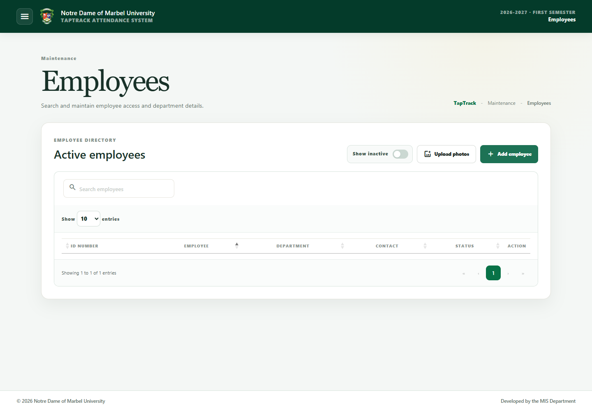

Adding, editing, deactivating, reactivating, importing, and uploading photos follow the same process as the student directory. Employees use the separate **Employee departments** directory; no employee role field is required. A re-uploaded matching inactive employee becomes active again.

If an inactive employee scans an ID, TapTrack directs the employee to MIS for reactivation.

Bulk employee photo selections are also queued automatically with no overall photo-count limit.

## 9. Card enrollment

Open **Card enrollment**, or choose **Enroll card** from a student, employee, or alumni row. Access follows the account's card enrollment permission; an enrollment operator can use the dedicated page without access to directory editing.

1. Connect the HID card reader to the computer performing enrollment.
2. Select the person and verify the name, ID number, and photo in the enrollment dialog.
3. Focus **Card ID** and tap the card. The reader enters the card's default number; scanning again replaces the previous value.
4. Select **Save card**, then confirm the enrollment in the confirmation dialog. The reader's Enter key does not save the card.

Card numbers are managed through enrollment rather than the person-editing form. Alumni use a separate physical card; enroll it on the alumni record. Kiosks accept either the person's ID number or enrolled card number. Enrollment saves the number in TapTrack without writing to the card.

## 10. Academic maintenance

Create parent records before child records. Avoid deleting or deactivating records that are still referenced by people or attendance data.

### Schools

Schools are the top level of the academic hierarchy. Use **Add school**, or select the edit icon on an existing row. Use **Show inactive** to include inactive records.

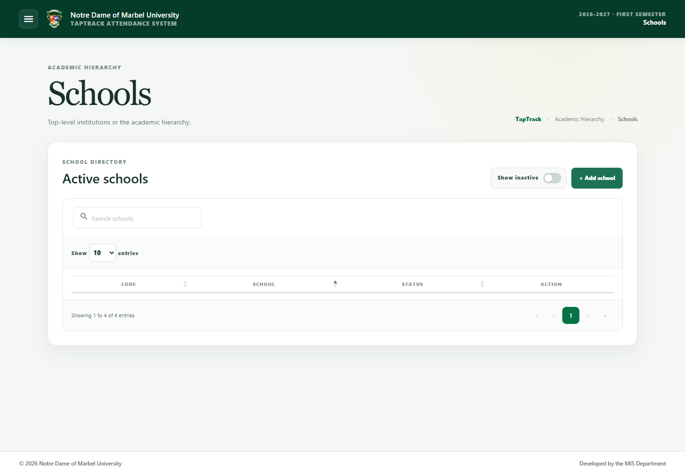

### Colleges

Create colleges under their parent school. Codes should be short, unique, and consistent with import files.

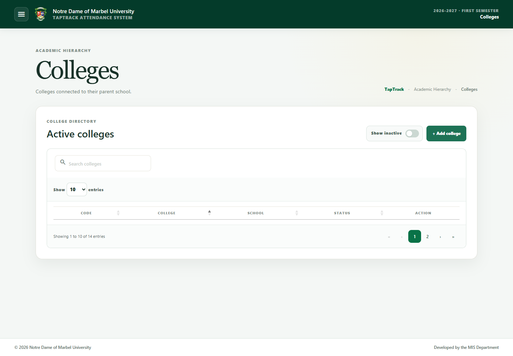

### Student departments

Departments used by student programs belong to the academic hierarchy.

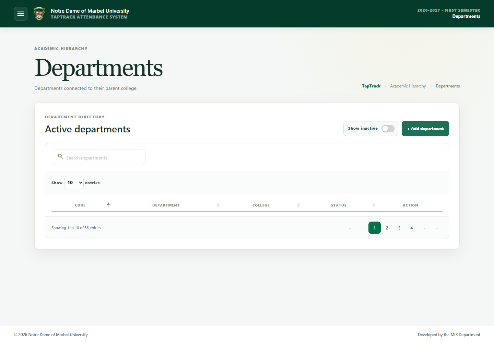

### Employee departments

Employee departments are maintained separately and are selected directly on employee records.

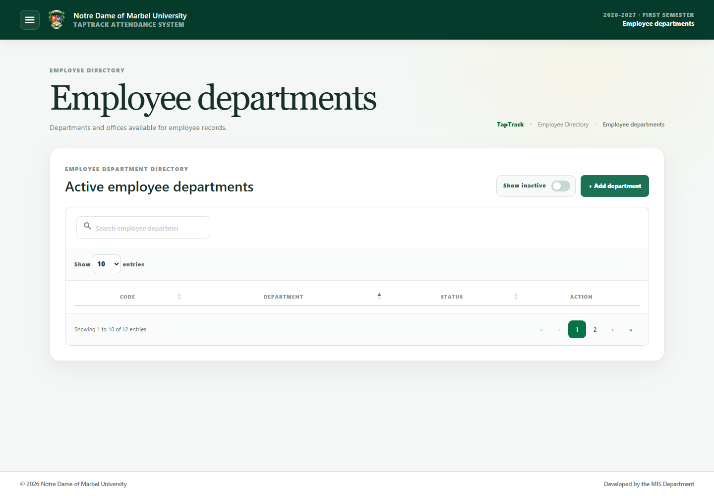

### Programs

Create each program under the correct parent department. Program codes are used in student imports and exports.

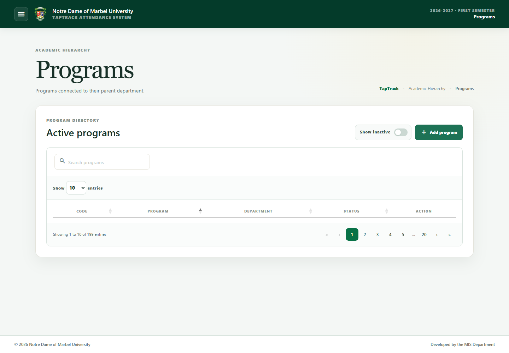

### Academic periods

Academic periods determine where current records are stored and which historical records can be loaded.

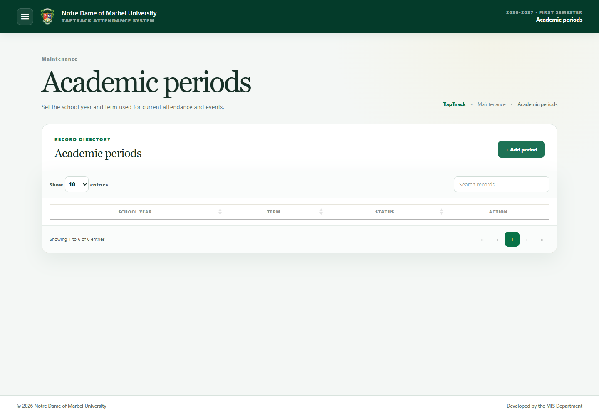

Available terms include First Semester, Second Semester, Summer, First Term, Second Term, and Third Term. Only the period intended for current operations should be marked **Current active period**. Verify the school year and term carefully before activating it.

## 11. System settings

Open **Maintenance → System settings** to configure system-wide options presented by the page.

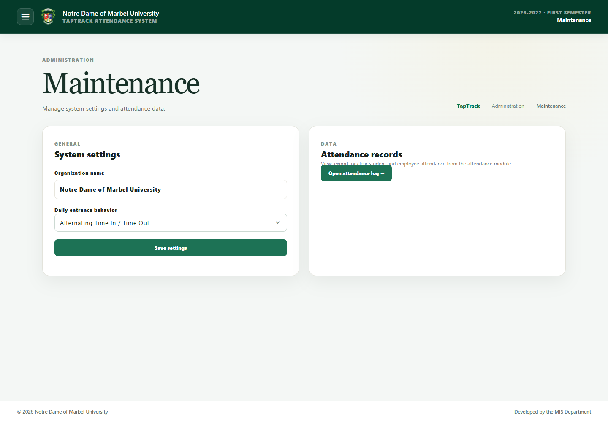

Changes affect all users or kiosks. Record the reason for operational changes and test scanners after modifying scanner-related settings.

## 12. Users and access

### Activity log

Open **Users & access → Activity log** to review sign-ins and administrative activity. Search or filter to investigate an account or operation.

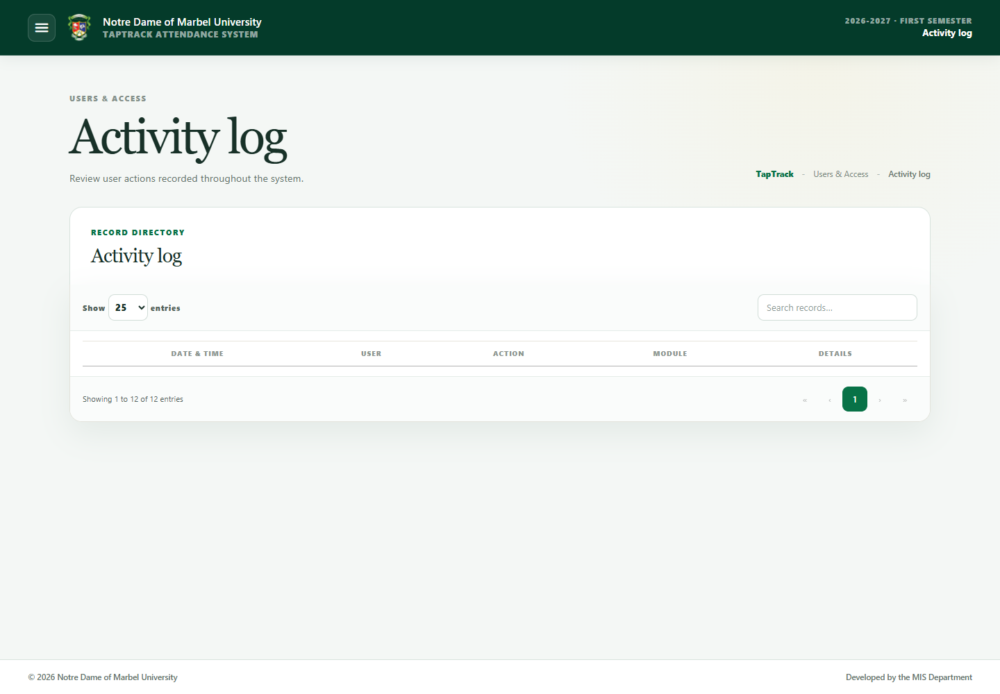

### Permissions

Permissions define which modules a role can access and whether its directory scope includes students, employees, or both.

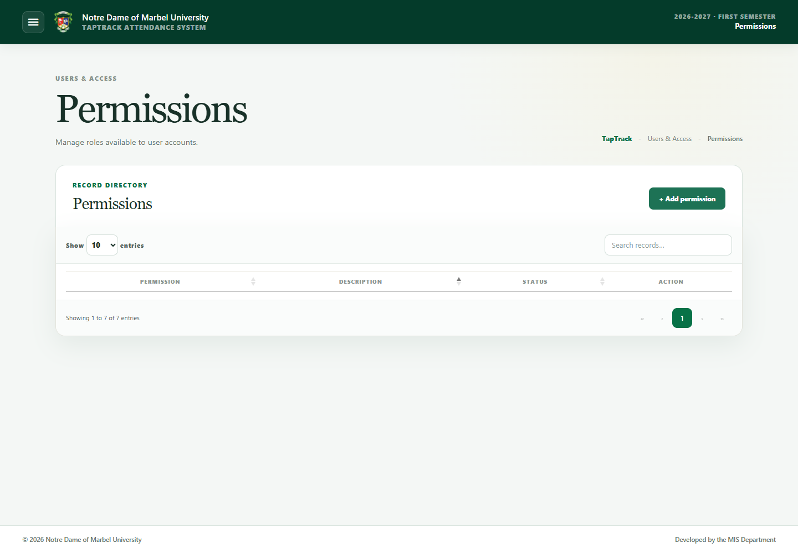

To add a permission:

1. Select **Add permission**.
2. Enter a clear description/name.
3. Enable only the required modules: Overview, Attendance, Events, Historical data, Library, Maintenance, and/or User & access.
4. Select the visible-people scope.
5. Leave **Active permission** on when the role may be assigned.
6. Save.

Use least privilege: do not grant Maintenance or User & access unless the person's work requires it.

### User management

Open **Users & access → User management** to create or update staff accounts.

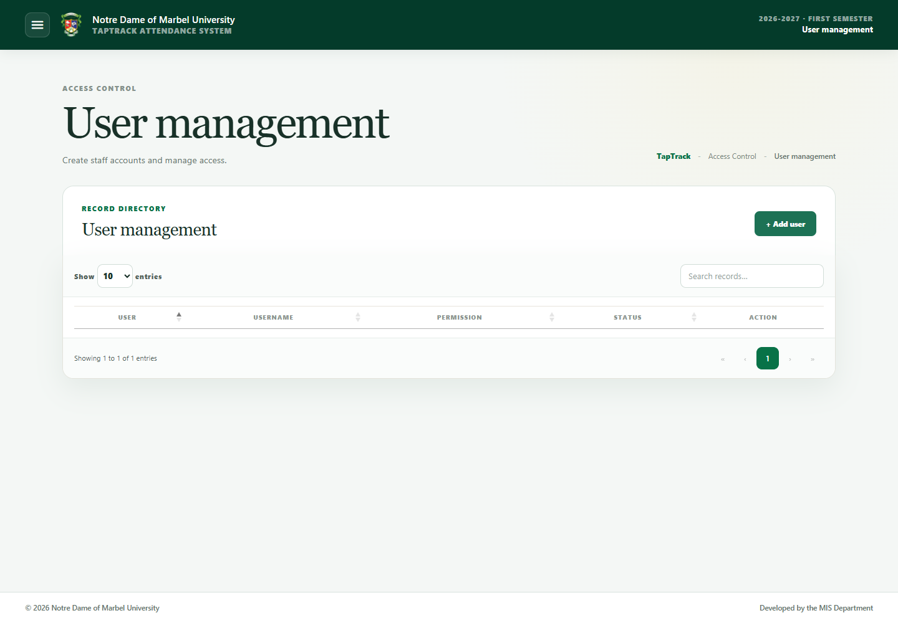

When adding a user, enter the name, unique username, optional institutional email where applicable, initial password, permission, and active status. Deactivate accounts that should no longer sign in. Do not reuse a shared Superadmin account for routine work.

## 13. Change password and sign out

Select **Password** in the navigation footer. Enter the current password, a new password of at least eight characters, and confirmation, then save.

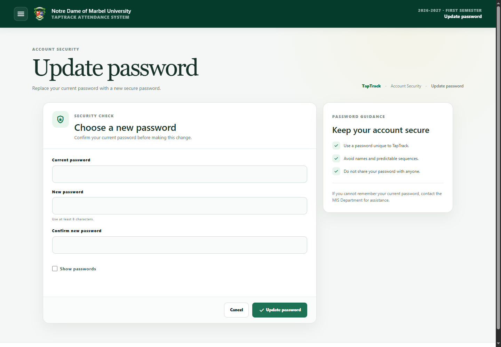

Select **Sign out** when finished, especially on shared terminals.

## 14. Kiosks and scanners

Public kiosk paths are provided by MIS for university entrance, library, and Internet Section scanning. Authorized input methods include typed IDs, keyboard-wedge RFID/barcode readers, and supported camera scanning.

### Verify a new kiosk

The first time a kiosk is opened, TapTrack blocks scanning and asks for a **Superadmin username and password**. Successful verification enrolls that browser without exposing or storing the password. The secure kiosk cookie renews automatically for another 30 days whenever the kiosk is used, so routine visits do not ask for the password again.

Clearing the browser cookies or its kiosk device identity requires verification again. Failed verification attempts are rate-limited and written to the activity log. Never allow an unverified terminal to be used for attendance.

### Manage kiosks centrally

Open **Maintenance → Kiosks** to review registered devices and their recent status. A Superadmin or Administrator can enable or disable a kiosk and send the supported browser or computer actions. Disabling a kiosk immediately revokes its session and rejects subsequent scans. Re-enabling it requires a new Superadmin verification.

- Manual keyboard input remains available even when no scanner is assigned.
- A camera requires a secure browser context. Use the HTTPS university URL approved by MIS; normal browsers block camera access on a LAN HTTP URL.
- A paired two-scanner university kiosk can distinguish Time In and Time Out devices through the scanner helper.
- Enter a clear terminal location in the scanner modal. Every scan records that location.
- Pairing/assignment input must not be treated as attendance.
- Rapid duplicate scans at the Library or Internet Section are rejected while the first scan is being processed.

## 15. Troubleshooting

| Problem                            | What to do                                                                                                     |
| ---------------------------------- | -------------------------------------------------------------------------------------------------------------- |
| Invalid username/password          | Check spelling and Caps Lock. Ask MIS to verify the active account; do not repeatedly guess.                   |
| Inactive student/employee          | Refer the person to MIS and reactivate only after authorization.                                               |
| Camera is unavailable              | Open the approved HTTPS URL, allow camera permission, close other apps using the camera, and reload.           |
| Card number is not entered         | Check the HID reader connection, focus the Card ID field, and tap the card again.                              |
| Scanner types but does not submit  | Configure the keyboard-wedge scanner to append Enter after the ID.                                             |
| Wrong scan action/location         | Confirm the assigned device direction and terminal location before scanning.                                   |
| Kiosk asks for verification        | Have a Superadmin verify the device. If it was disabled, re-enable it in Kiosk management first.               |
| Kiosk scan is rejected             | Confirm that verification succeeded and that the kiosk is enabled. Unverified kiosks cannot submit scans.      |
| SQL Server preview takes time      | Keep the dialog open and wait for the processing message to finish. Do not repeatedly start another preview.   |
| Invalid SQL Server row             | Correct the registrar view value shown under Invalid rows, then preview again.                                 |
| Some photo filenames are unmatched | Rename each file to the exact student or employee ID number, then upload those files again.                    |
| A table is slow                    | Narrow the search/filter and select a suitable page size. Report persistent delays to MIS.                     |
| Page/API error after deployment    | Confirm that the latest `database.sql` was applied, restart TapTrack, and give the server error to MIS.        |

## 16. Data protection and backup

- TapTrack is for internal university-network use.
- Export only the records needed for an authorized purpose.
- Store exported workbooks securely and delete temporary copies when no longer needed.
- Back up both the MySQL database and `uploads/profile-photos`.
- Do not edit database rows directly during normal operation; use the TapTrack interface so actions remain auditable.
- Use HTTPS in production. Staff sessions are stored in secure HttpOnly cookies and are invalidated when the user signs out.
- Apply `database.sql` during deployment; production runtime schema changes are disabled by default.
